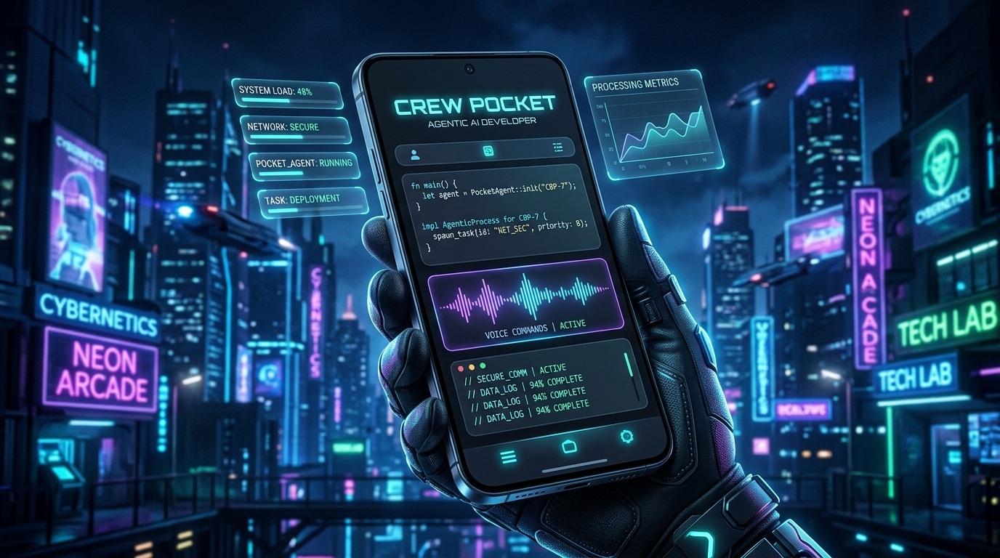

# Crew Pocket｜口袋 AI 小隊

  

  **把你的 AI 開發小隊，放進口袋。**

  以 Role 為核心、資料優先保存在本機的 AI 助理與多 Agent 協作工作台，讓你用 Android 手機管理 CLI AI。

  [English](README.md) · [繁體中文](README.zh-TW.md)

  
  
  

## Crew Pocket 是什麼？

Crew Pocket 不只是把 CLI 的聊天畫面搬到手機，而是把 AI 助理組成一支**有長期身分的 Role 小隊**。每位 Role 都可以有自己的名稱、指令、專案／工作目錄、目前對話、記憶與技能。你可以切換角色、延續工作，也能讓角色互相傳話，而不必複製彼此整份 Context。

目前主要部署方式是 **Android APK + Termux 裡的 Node.js Runtime**。APK 是連向本機服務的 WebView 外殼，**不內建** Node.js 或 AI CLI。一般瀏覽器也能開啟同一個本機介面做除錯；有需要時，還能透過 Remote Console 讓同一個可信任區網內的電腦連線操作。

> **專案狀態：** 持續開發與實驗中。部分功能依賴特定 Provider、Android 設定或實機驗證；不同 Provider 的功能並不完全相同。

## 核心特色

- **Role-first 架構**：每個 Role 有獨立身分、目前工作對話、專案背景與工作目錄；不再以零散對話作為管理中心。
- **多 Agent 溝通**：角色可以把明確訊息送到另一位角色目前的對話。另有任務委派與狀態追蹤，但執行模式受到 Runtime 與 Provider 限制。
- **Memory + Dreaming**：本機持久記憶，搭配可設定的閒置時段反思，產生記憶與 Skill 候選。Dreaming 使用 Codex，須有可用且已登入的 Provider，並不是內建的免費雲端模型。
- **Skill DNA**：角色技能具備候選、驗證、啟用、退役等生命週期。產生候選或符合觸發條件，不代表技能已經由 AI 自動驗證成功。
- **Context Health / AutoCompact**：Context 來源貢獻估算、預算警示、可追溯組裝、安全壓縮規劃與選用的 AutoCompact 訊號。部分 Token 數值是估算，不等同計費用量。
- **Tool Improvement Loop**：從工具使用、失敗與恢復證據整理改善候選；不會直接把建議當成已修好的程式碼。
- **互動式 AI 回覆**：串流對話、可收合的執行結果、內嵌 HTML／SVG 沙盒、視覺化閱讀，以及 \`crew-ui\` 選項、清單、圖表、方案和計算器。
- **手機優先操作**：Android WebView、檔案管理、附件、選用的語音功能與無線偵錯工具；實際可用性會因 Provider 和 Android 環境而異。
- **電腦輔助操作**：透過 Crew Home／Remote Console 在可信任的同一區網使用手機上的 Runtime，連線權限仍由手機控制。

## AI Provider 支援

| Provider | 狀態 | 說明 |
| --- | --- | --- |
| **Google Antigravity CLI（\`agy\`）** | 安裝器預設 | 常駐 Session、對話紀錄與 AGY 專屬功能。 |
| **OpenAI Codex CLI（\`codex\`）** | 選用 | 使用持久化 \`codex app-server\`，支援工具事件串流、模型／推理設定與原生 Context 壓縮。 |
| **Claude Code CLI（\`claude\`）** | 預覽版／自備 CLI | 必須在**執行 Runtime 的同一台主機**安裝並登入。Android APK 不內建 Claude；精確 Context 用量、原生 Compact 等功能尚未支援。 |

模型、登入、工具權限及費用都取決於各 CLI 與帳號設定。切換 Provider **不會**自動搬移原生 Session，也不會合併另一個 Provider 的對話歷史。詳見 [Claude Code Provider 說明](docs/claude-code-provider.md)。

## 快速安裝（Android / Termux）

### 1. 安裝 Termux

建議透過官方 [F-Droid](https://f-droid.org/en/packages/com.termux/) 或 [Termux GitHub Releases](https://github.com/termux/termux-app/releases) 安裝。

### 2. 執行安裝器

打開 Termux，輸入：

\`\`\`bash
curl -fsSL https://raw.githubusercontent.com/magic76/crew-pocket/main/install.sh | bash
\`\`\`

安裝器會準備最小化的 Node.js／Git／curl 環境、下載或快轉更新專案，再讓你選擇安裝 **AGY、Codex、兩者都裝**，或暫時略過。Termux 預設專案路徑是 \`~/agy-web\`。如果希望先審核遠端腳本，可先閱讀 [install.sh](install.sh)。

AGY 會經由上游安裝器安裝；Android 上的 Codex 選項使用社群維護的 \`@mmmbuto/codex-cli-termux\`。兩者都是外部相依項目，並非由 Crew Pocket 直接提供的執行檔。

### 3. 登入 AI Provider 並啟動

依你選用的 Provider 完成登入：

\`\`\`bash
agy             # 使用 Antigravity 時，首次互動登入
codex login     # 使用 Codex 時登入
\`\`\`

接著：

\`\`\`bash
crew doctor     # 檢查環境與 Provider
crew start      # 啟動本機 Runtime
\`\`\`

服務會啟動在 **http://127.0.0.1:8000**。平常建議透過 Crew Pocket Android APK 操作；也能從瀏覽器開啟這個網址做測試。注意 \`crew start\` 會重新啟動 Node 服務，執行中的工作回合不適合此時重啟。

### 4. 選用：Android APK 外殼

**Termux 安裝器不會替你安裝 APK**，必須另外建置或安裝 Android Wrapper。要讓 APK 可以要求 Termux 啟動 Runtime，請先執行：

\`\`\`bash
cd ~/agy-web
bash scripts/enable-android-wrapper.sh
\`\`\`

安裝 APK 後，還需在 Android 的額外權限中允許 Crew Pocket **「在 Termux 環境中執行命令」**。完整建置、權限、無線偵錯快速配對及自動重連，請參閱 [Android Wrapper 文件](android-wrapper/README.md)。

## 常用指令

| 指令 | 用途 |
| --- | --- |
| \`crew doctor\` | 檢查 Node.js、專案、Provider、儲存權限與服務狀態。 |
| \`crew start\` | （重新）啟動本機 Runtime。 |
| \`crew status\` / \`crew stop\` | 查看或停止 Runtime。 |
| \`crew update\` | 從 \`origin/main\` 快轉更新專案，之後需重新啟動 Runtime。 |
| \`crew roles\` | 列出所有 Role ID，方便從 CLI 傳訊。 |
| \`crew send <發送者-role-id> <接收者-role-id> <訊息>\` | 透過執行中的 Runtime 傳送 Role-to-Role 訊息。 |

例如：

\`\`\`bash
crew roles
crew send role-general role-myproject "請檢查目前建置錯誤。"
\`\`\`

上面的 Role ID 只是示意；實際請以 \`crew roles\` 輸出為準。傳送的只有**明確寫出的訊息**，接收方仍使用自己的記憶、專案、工作目錄與目前對話。

## 架構概覽

\`\`\`text
Android APK（WebView）／本機瀏覽器／選用的區網 Remote Console
                            |
                       Node.js Runtime
                            |
       +--------------------+--------------------+
       |                    |                    |
   Role / Chat          Context / Memory      Task / Tool
     編排                 / Skill DNA           回饋與分析
       |                    |                    |
       +--------------------+--------------------+
                            |
                  AGY / Codex / Claude CLI
                    （安裝在 Runtime 主機）
\`\`\`

- \`server.js\`：本機 HTTP、SSE 與 API 入口。
- \`lib/\`：Provider、Role Runtime、角色通訊、記憶、技能、Context 與任務執行。
- \`public/\`：Android WebView 與瀏覽器共用的 Web UI。
- \`android-wrapper/\`：APK 外殼及 Android／Termux 橋接。
- \`docs/\`：機制說明；\`test/\`、\`tests/\`：針對性回歸測試。

原始對話紀錄與 Role 資料保留在本機；Context 壓縮是整理模型工作脈絡，**不是刪掉使用者的歷史紀錄**。Runtime 才是單一資料來源，Remote Console 只是另一個操作入口，不是同步出另一台 Agent 主機。

## 更新與開發

\`\`\`bash
crew update
crew start
\`\`\`

修改 \`public/\`、\`server.js\`、\`lib/\`，一般只需拉取新版並重新啟動 Runtime；更動 \`android-wrapper/\`、Android 權限或 Native Bridge 才需要重新建置／安裝 APK。

貢獻程式前，請閱讀 [AGENTS.md](AGENTS.md) 和 [GEMINI.md](GEMINI.md)，針對修改的檔案執行必要的語法檢查與測試，並保留既有對話與記憶資料。

## 安全性與限制

- **本機優先**：Runtime 預設只監聽 \`127.0.0.1\`。請勿將 API 直接暴露到公網；區網模式必須由手機明確啟用，Remote Console 會進行連線授權。
- **AI 能使用工具**：開放專案檔案、裝置或 Shell 權限前，請先了解 Provider 的核准與沙盒設定；AI 產生的回報不等於實際測試證據。
- **角色記憶不共用**：角色互動以明確訊息為主，不會直接把另一個角色的私人記憶或完整對話複製過去。
- **不是雲端模型服務**：需要自行安裝並登入 CLI；本專案不提供付費 LLM 訂閱。
- **Android 環境相依**：APK 仍依靠 Termux 與本機 Runtime。ADB 快速配對與重連需要 Android 無線偵錯及使用者授權；實機與不同 Provider 的相容性仍須驗證。

## 延伸文件

- [Android Wrapper 與無線偵錯](android-wrapper/README.md)
- [Claude Code 預覽版：設定與限制](docs/claude-code-provider.md)
- [互動式回覆格式與安全邊界](docs/interactive-replies.md)
- [AI 開發規範](AGENTS.md)

## 參與貢獻與授權

歡迎提出 Issue、錯誤回報與範圍明確的 Pull Request。若涉及 Android WebView、Termux、Provider、Role 隔離或對話保存，請附上重現步驟與驗證結果。

本專案採用 [MIT License](LICENSE)。
